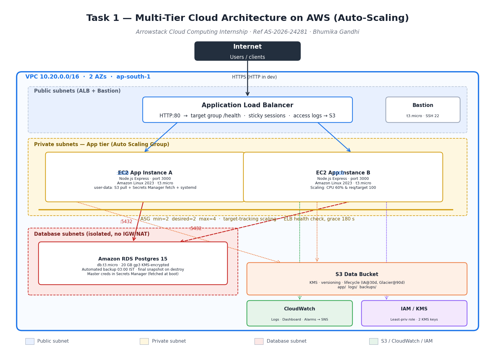

# Arrowstack Task 1 — Multi-Tier Cloud Architecture on AWS with Auto-Scaling

> **Intern:** Bhumika Gandhi · **Ref ID:** AS-2026-24281 · **Domain:** Cloud Computing
> **Tenure:** Nov 7, 2026 → Dec 7, 2026 (1 Month)

A production-grade, multi-tier AWS architecture deployed entirely with Terraform. A stateless Node.js business API runs on an EC2 Auto Scaling Group behind an Application Load Balancer, with a managed Amazon RDS Postgres database, least-privilege IAM, KMS-encrypted S3 storage, VPC flow logs, CloudWatch monitoring & alarms, and a disaster-recovery runbook.

This project satisfies all required features in the Arrowstack Task 1 brief:
**IAM least privilege · Configuration/secrets management · Monitoring/logging · Backup/recovery plan · Cost-awareness notes**

---

## 1. Architecture at a Glance



| Tier | Service | Purpose |
| --- | --- | --- |
| Edge | Route 53 (optional) + ALB | Public HTTPS endpoint, health checks, sticky sessions |
| App | EC2 Auto Scaling Group (`t3.micro` ×2–4) | Stateless Node.js Express API in private subnets |
| Data | Amazon RDS Postgres 15 (`db.t3.micro`, Multi-AZ in prod) | Managed, encrypted, automated backups |
| Storage | S3 (data + access logs) | KMS-encrypted, versioned, lifecycle-managed |
| Security | IAM role + instance profile, Security Groups, KMS, Secrets Manager | Least-privilege, no plaintext credentials |
| Observability | CloudWatch Logs, Metrics, Dashboard, Alarms, SNS | Single pane + email alerting |
| Network | VPC, 2 AZs, public/private/DB subnets, NAT, IGW, VPC Flow Logs | Defense in depth, isolated DB tier |

---

## 2. Repository Layout

```
task-1-cloud-architecture/
├── terraform/
│   ├── providers.tf             # AWS provider + tags
│   ├── variables.tf             # All tunable inputs
│   ├── main.tf                  # Root composition wiring all modules
│   ├── outputs.tf               # Useful outputs (ALB DNS, RDS endpoint, etc.)
│   ├── terraform.tfvars.example # Copy → terraform.tfvars and edit
│   └── modules/
│       ├── vpc/                 # VPC + 3 subnet tiers + NAT + Flow Logs
│       ├── alb/                 # Internet-facing ALB + target group
│       ├── asg/                 # Launch template + ASG + scaling policies + bastion
│       ├── rds/                 # RDS Postgres + KMS + Secrets Manager
│       ├── iam/                 # Least-privilege EC2 instance profile
│       ├── s3/                  # Data + access-log buckets with KMS + lifecycle
│       └── cloudwatch/          # Log groups, dashboard, alarms, SNS wiring
├── app/                         # Sample Node.js Express business API
│   ├── server.js
│   ├── package.json
│   ├── Dockerfile
│   └── .dockerignore
├── tests/
│   ├── app.test.js              # Smoke tests against ALB
│   └── test_terraform.py        # fmt + init + validate IaC
├── docs/
│   ├── architecture.png         # Generated diagram
│   ├── REQUIREMENTS.md
│   ├── ARCHITECTURE.md
│   ├── BACKUP_RECOVERY.md
│   ├── COST_ANALYSIS.md
│   └── RUBRIC_MAPPING.md
├── .gitignore
└── README.md                    # this file
```

---

## 3. Prerequisites

| Tool | Version | Why |
| --- | --- | --- |
| Terraform | ≥ 1.5 | IaC engine |
| AWS CLI | ≥ 2.13 | Configure credentials |
| Node.js | ≥ 20 | Run / test the sample app locally |
| Docker | ≥ 24 | (Optional) containerise the app |
| Python 3 | ≥ 3.10 | Run `tests/test_terraform.py` |

**AWS account requirements**

- An IAM user / role with permission to create VPC, EC2, RDS, S3, IAM, Secrets Manager, CloudWatch, KMS, SNS resources.
- A service quota that allows ≥ 2 `t3.micro` EC2 instances and 1 `db.t3.micro` RDS in your chosen region.
- An existing EC2 key pair (default name `arrowstack-task1-key`) for SSH access to the bastion.

---

## 4. Deploy — Step by Step

```bash
# 1. Configure AWS credentials
aws configure
# (or) export AWS_PROFILE=your-profile

# 2. Enter the terraform directory
cd terraform

# 3. Copy and edit tfvars
cp terraform.tfvars.example terraform.tfvars
#   - update owner_email, ssh_key_name, allowed_ingress_cidrs for prod

# 4. Initialise providers & modules
terraform init

# 5. Validate the configuration
terraform validate

# 6. Dry-run — review every resource before creating
terraform plan -out tfplan

# 7. Apply
terraform apply tfplan

# 8. Capture the ALB DNS
terraform output alb_dns_name   # e.g. arrowstack-t1-dev-alb-123456.ap-south-1.elb.amazonaws.com

# 9. Smoke-test the deployed API
ALB_URL="http://$(terraform output -raw alb_dns_name)" && \
  curl -s "$ALB_URL/health" | jq .

# 10. Upload the sample app to S3 so EC2 user-data can fetch it
cd ../app && tar -czf app.tar.gz server.js package.json Dockerfile
aws s3 cp app.tar.gz "s3://$(terraform output -raw data_bucket)/app/app.tar.gz"

# 11. Trigger a rolling instance refresh so the ASG picks up the new code
aws autoscaling start-instance-refresh \
  --auto-scaling-group-name "$(terraform output -raw asg_name)"
```

After step 11, the ASG will replace instances one-by-one; the new instances pull `app.tar.gz` from S3, install Node deps, fetch DB credentials from Secrets Manager and register behind the ALB.

---

## 5. Run the App Locally (without AWS)

```bash
cd app
npm install
# Start a local Postgres (e.g. docker run -d -p 5432:5432 -e POSTGRES_PASSWORD=postgres postgres:15)
APP_PORT=3000 DB_HOST=127.0.0.1 DB_NAME=postgres DB_USER=postgres DB_PASSWORD=postgres npm start
```

```bash
# In another terminal
curl http://localhost:3000/health
curl -X POST http://localhost:3000/items -H 'content-type: application/json' \
  -d '{"name":"Widget","price":9.99}'
curl http://localhost:3000/items
```

---

## 6. Tests

```bash
# IaC tests (need terraform CLI in PATH)
python3 tests/test_terraform.py

# App smoke tests (need ALB up, or set ALB_URL=http://localhost:3000)
cd app && npm install && ALB_URL=http://localhost:3000 npx jest ../tests/app.test.js
```

---

## 7. Tear Down

```bash
cd terraform
# Delete RDS final snapshot to avoid orphaned cost
terraform destroy -auto-approve \
  -var="environment=dev" \
  -target=module.rds
terraform destroy -auto-approve
```

---

## 8. Key Design Decisions

- **Three subnet tiers** (public / private / database) — the DB tier has no route to the internet, only the app tier can reach it on port 5432.
- **Stateless app tier** — sessions are offloaded to the ALB (cookie stickiness) so any instance can serve any request, and the ASG can scale in/out freely.
- **Secrets Manager, not env vars** — the DB password is generated at apply time, encrypted with KMS, fetched by EC2 user-data over the AWS API; never written to tfstate or to disk in plaintext.
- **Single NAT gateway in dev** — saves ~$32/month; flip `single_nat_gateway=false` in prod for HA per-AZ NAT.
- **Target-tracking scaling** on both CPU (60% target) and ALB request-count-per-target (100) — simpler than step scaling and self-stabilising.
- **VPC Flow Logs** to CloudWatch — audit evidence for who talked to what.
- **Cost tags applied globally** via the provider `default_tags` block — every resource is queryable in Cost Explorer by `Project=Arrowstack-Task1-CloudArchitecture`.

---

## 9. Evidence & Validation

See `docs/`:
- `REQUIREMENTS.md` — stakeholder, success metrics, acceptance criteria traceability
- `ARCHITECTURE.md` — deep dive on each tier and the data flow
- `BACKUP_RECOVERY.md` — RPO/RTO, restore drills, DR runbook
- `COST_ANALYSIS.md` — line-item monthly estimate for dev and prod
- `RUBRIC_MAPPING.md` — every rubric criterion mapped to evidence

---

## 10. Limitations & Next Steps

- HTTPS is not terminated on the ALB in dev (HTTP only) — add ACM cert + HTTPS listener for prod.
- The bastion is exposed to `var.allowed_ingress_cidrs` — tighten to a corp egress IP or remove `enable_bastion` and use SSM Session Manager instead.
- No CI/CD pipeline — wire this repo into GitHub Actions to run `terraform plan` on PRs.
- RDS is single-AZ in dev — switch to Multi-AZ for prod.
- No WAF or AWS Shield Advanced — add for internet-facing production.

---

## 11. License & Authorship

Built by **Bhumika Gandhi** for the Arrowstack Batch 2026 Cloud Computing internship. Source is released under the MIT License — see `LICENSE` (or include one if you fork). Tag `@Arrowstack` in any LinkedIn post you publish about this project.
